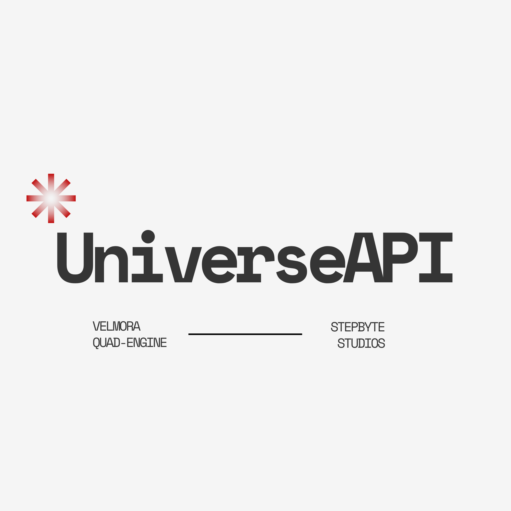

<p align="center"></p>

# UniverseAPI Engine

The single backend behind **Velmora**: catalog, metadata, trending, streaming and
downloading in one Rust crate. It unifies **ani-cli**, **MovieBox-TUI**,
**freeflix-cli** and the **HDHub custom API**.

```
universeapi/
├── crates/universeapi       # the engine (library, no UI, Windows + Android)
└── crates/universeapi-cli   # dev/CI front-end: search, sources, daily live smoke test
```

> Builds, tests and releases run **only in GitHub Actions**
> ([workflow](../.github/workflows/universeapi.yml)), never on a dev machine.

## What's in it (v0.1)

| Layer | Contents |
|---|---|
| Metadata | **TMDB** (when a key is configured) · **Cinemeta** (no key, fallback) · **AniList** (anime trending, airing today, MAL ids) |
| Providers | **MovieBox** (signed aoneroom API: DASH + direct MP4, captions, language dubs, placeholder recovery) · **4KHDHub** (4K/1080p releases, season packs) · **HDHub** (custom API: Typesense search, listings, posts, episodes, packs) · **Dramachi** (Asian dramas, dub versions) · **Anime-Sama** (VOSTFR/VF anime) · **French-Stream** (VF/VFQ/VOSTFR films and series) · **Coflix** (French films and series) · **YTS**, **EZTV**, **Nyaa** (magnet sources by IMDb id or episode, ranked below direct links) · **ZokoAnime** (direct by MAL id) · **HiAnime** (ani-cli port) |
| Resolvers | HubCDN · HubDrive · HubCloud (junk-filtered) · HBLinks · HBPlay · GreenMotors (gate decoded over plain HTTP, WebView fallback) · HDStream4U (P.A.C.K.E.R → HLS) · PixelDrain · French player embeds (uqload, fsvid, vidzy, ansembed/vidmoly, VOE mirrors, sibnet, sendvid, filemoon family) · ZokoAnime (XOR blob → HLS + subs) |
| Engine | merged search (progressive stream), home rails, cross-provider source gathering, **1 KB range-probe verification** (drops ad/decoy pages), preference-driven ranking |
| Torrents | librqbit session (feature `torrent`, on by default): picks the episode inside season packs, streams while downloading with a seekable reader, pauses when done unless seeding is turned on |
| Infra | retry + jittered backoff, Cloudflare detection + pluggable fallback transport, two-level TTL cache (memory + disk), release-name parser |

Planned in the next drops: the `wreq` Chrome-fingerprint fallback, the
download manager (ffmpeg sidecar) and the media proxy.

## Usage

```rust
use universeapi::{Engine, EngineOptions, Registry, model::{Target, AudioMode}};

let engine = Engine::new(EngineOptions {
    registry: Registry::default().with_env_overrides(),
    cache_dir: Some(app_cache_dir),
    ..Default::default()
})?;
engine.refresh_registry("https://raw.githubusercontent.com/ashfaqizop/Velmora/config/registry.json").await?;

let rails = engine.home().await;
let hits = engine.search("frieren").await;
let report = engine.sources(&hits[0], Target::Episode { season: 1, episode: 1 }, AudioMode::Sub).await;
```

## Remote configuration (domain rotation)

HDHub and friends rotate domains constantly. Nothing domain-specific is
hard-wired: the app fetches `registry.json` from the repo's `config` branch on
every launch and layers it over built-in defaults, so **a dead domain is fixed
with a one-line commit, not an app release**. See
[`registry.example.json`](registry.example.json).

HDHub mirror resolution order:

1. `hdhub.force_mirror`, an emergency override
2. the cached mirror from the last successful resolution (24 h)
3. the live host-config CDN (`hdhub.host_cdn`)
4. the `mirrors.hd_hub` list

If the current mirror dies mid-session, the engine re-resolves and fails over automatically.

Hoster renames such as `hubcloud` → `hubkloud` are handled by `host_aliases`;
TLD-only rotations (`hubcloud.ist` → `hubcloud.foo`) need no change at all.

**Secrets never live in this repo.** TMDB credentials come from the environment:

| Variable | Used by |
|---|---|
| `UNIVERSEAPI_TMDB_READ_TOKEN` | TMDB v4 bearer token (preferred) |
| `UNIVERSEAPI_TMDB_API_KEY` | TMDB v3 key |
| `UNIVERSEAPI_HDHUB_MIRROR` | force an HDHub mirror (debugging) |

In CI these come from the `TMDB_READ_TOKEN` / `TMDB_API_KEY` repository secrets.

## CLI

```
universeapi home
universeapi search "dune"
universeapi sources "frieren" --episode 3
universeapi sources "akka" --season 1 --pack
universeapi smoke --report smoke.json
```

`smoke` runs daily in CI against the live sites. If a critical check fails, the
workflow opens (or updates) a `smoke-failure` issue.

## License

GPL-3.0-or-later.
